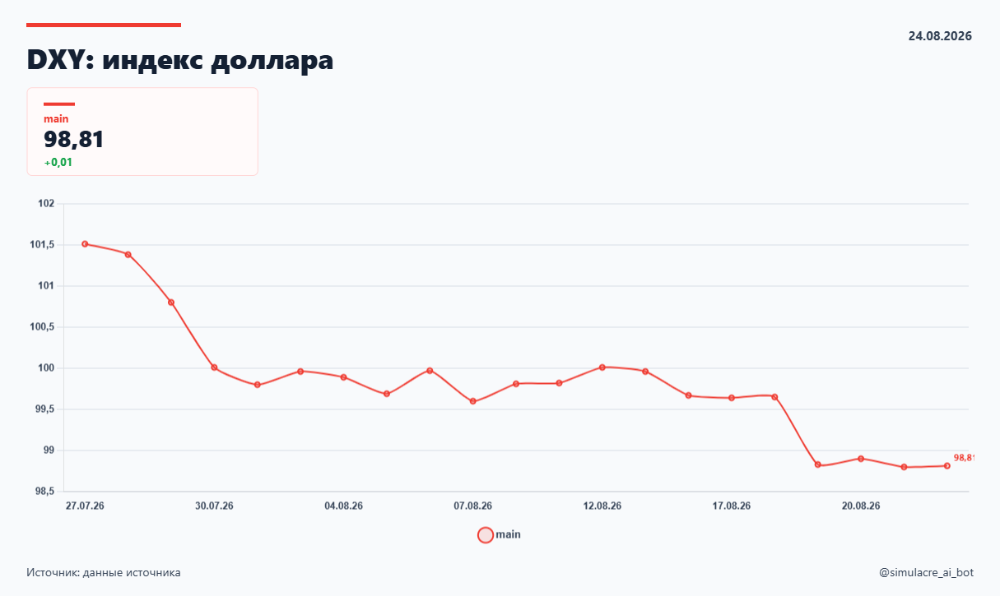
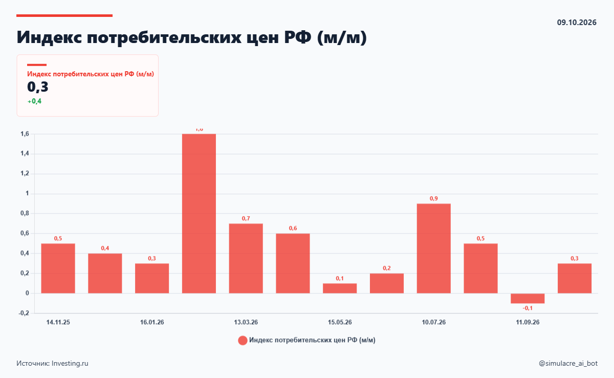
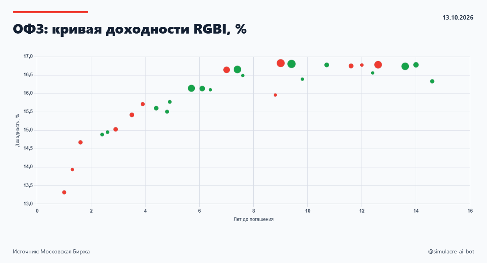

<div align="center">
  <h1>Simulacre Financial Charts</h1>
  <p><strong>Financially correct charts. Reproducible visual decisions.</strong></p>
  <p>An open-source Agent Skill for designing, implementing, auditing and exporting financial and macroeconomic charts.</p>
  <p>
    <a href="https://agentskills.io/specification"></a>
    <a href="LICENSE"></a>
    
    
  </p>
  <p><a href="#quick-start">Quick start</a> · <a href="#how-it-works">Workflow</a> · <a href="#chart-gallery">Gallery</a> · <a href="#validation">Validation</a> · <a href="docs/README.ru.md">Русский</a></p>
</div>

---

## Why this skill?

A polished chart can still be financially wrong: a misleading zero baseline, a weekly series aligned to the wrong calendar, an interpolated observation presented as fact, or a trend implied by unrelated maturities. This skill combines **financial semantics**, **chart-pattern selection**, **visual references** and **render/export checks**.

Its design references were collected from [Simulacre AI's macro dashboard](https://simulacre-ai.ru/site/). The October 2026 audit inventoried **53 macro indicators**, including seven representative images kept in this repository. This is a portable instruction/reference skill, **not the source code of Simulacre**, a live data client, or a packaged rendering library.

## Chart gallery

<table><tr>
<td align="center" width="33%"><a href="skills/simulacre-financial-charts/assets/reference-charts/global-dxy.png"></a><br><sub>Level / line</sub></td>
<td align="center" width="33%"><a href="skills/simulacre-financial-charts/assets/reference-charts/russia-cpi-mom.png"></a><br><sub>Period change / bars</sub></td>
<td align="center" width="33%"><a href="skills/simulacre-financial-charts/assets/reference-charts/russia-ofz-yield-curve-monitor.png"></a><br><sub>Bond cross-section / scatter</sub></td>
</tr></table>

See the [pattern catalog](skills/simulacre-financial-charts/references/simulacre-v1-pattern-catalog.md) and [reference manifest](skills/simulacre-financial-charts/references/reference-manifest.json). **Two reference files are explicitly screenshot fallbacks**, not successful PNG-button exports.

## Quick start

Install with an Agent Skills-compatible client:

```bash
npx skills add KaigorodovTuskul/simulacre-financial-charts-skill --skill simulacre-financial-charts
```

Or manually copy the complete `skills/simulacre-financial-charts/` folder to a supported client skills directory. Keep `references/`, `assets/` and `agents/` beside `SKILL.md`. Client discovery and automatic activation vary.

**Example task:**

> Use simulacre-financial-charts. Build a responsive chart of weekly Russian CPI with a clear current-year seasonal overlay. Distinguish observation date from publication date, label units correctly, preserve missing weeks, and verify the exported PNG matches the visible card.

The skill is library-agnostic. It can guide Chart.js, ECharts, Plotly, Matplotlib and other implementations without requiring a specific JavaScript framework.

## How it works

1. **Understand** the economic question, data semantics, frequency, units and observation/publication dates.
2. **Select** an appropriate pattern (line, signed flows, composition, seasonal comparison, dual-axis, yield scatter, heatmap or table).
3. **Render** a clear card with a consistent hierarchy and faithful values; consult reference PNGs rather than guessing the site's exact CSS.
4. **Check** the data, calendar alignment, baselines, annotations, accessibility and narrow-layout behavior.
5. **Export** only after a *render-ready gate*; verify the actual file content, not just a successful button click.

A hash-unique PNG or a nonzero file size is **not** proof of correct or complete rendering. Read [capture and export](skills/simulacre-financial-charts/references/capture-and-export.md) for the readiness and failure-handling protocol.

## What is covered?

| In scope | Not included |
| --- | --- |
| Financial chart choice and review | Live market-data access or guaranteed source correctness |
| Economic units, rates, levels, spreads, flows, calendar conventions | Model-trained visual similarity scores |
| Chart cards, legible mobile layout, reference-aligned exports | A drop-in production charting component library |
| Chart.js/DOM-export guidance and deterministic export alternatives | Proof that every original Simulacre export path is fixed |

The design colors documented in [`design-tokens.json`](skills/simulacre-financial-charts/references/design-tokens.json) are **measured PNG observations**, not a verified CSS source-of-truth. They should be adapted to the actual implementation and checked on both light and dark themes.

## Repository layout

```text
skills/simulacre-financial-charts/
  SKILL.md                        Portable operational instructions
  agents/openai.yaml              Client-specific metadata
  references/
    simulacre-v1-pattern-catalog.md  53-indicator research inventory
    financial-semantics.md           Chart/data semantic safeguards
    design-tokens.json              Measured colors and provenance
    indicator-catalog.json          Machine-readable 53-ID index
    reference-manifest.json         Seven reference-image statuses
    capture-and-export.md           Browser readiness/export protocol
  assets/reference-charts/       Seven calibrated image references
docs/                            Russian guide and research notes
examples/                        Sample user prompts
tests/                           Offline structure, manifest, scenario checks
scripts/validate.py              Dependency-free repository validator
.github/workflows/validate.yml   CI preflight
```

## Validation

Python 3.9+ is required **only for the repository validator and tests**, not to read the skill (see [compatibility notes](docs/COMPATIBILITY.md)):

```bash
python scripts/validate.py
python -m unittest discover -s tests -v
```

These checks verify structural integrity and pinned reference assets; they do **not** execute a browser or establish that a model produces better charts. Behavioral scenarios are proposals for future controlled model evaluation, not benchmark results. A separate optional `scripts/audit_playwright_archive.py` checks 51 ordinary PNGs plus two screenshot fallbacks from an explicitly supplied local ZIP, without publishing that archive.

## Credits and license

Chart references derive from the author's Simulacre AI portal; the underlying economic datasets may have independent source terms. The repository does not grant rights in third-party data or trademarks. See [audit notes](docs/METHODOLOGY.md), [contributing](CONTRIBUTING.md), [security](SECURITY.md) and the [MIT license](LICENSE).
